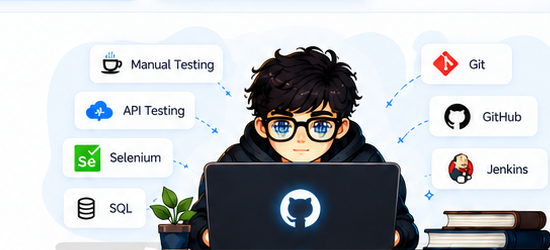

  

  <h1>👋 Hey, I'm Jayant Kumar Choudhary</h1>
  <h3>QA Engineer | Aspiring Product Manager | Automation & AI Enthusiast</h3>
  

   
  
  
  

---

## 👨‍💻 About Me

<table>
  <tr>
    <td width="58%" valign="middle">
      I'm a QA Engineer focused on software quality across web, Android, and iOS. I work on manual testing, API validation, backend checks, defect investigation, and release validation. I'm also developing my Product Management skills in product discovery, PRDs, roadmaps, and data-informed decisions.
        
      🔹 Manual, API, backend, web, and mobile testing 
      🔹 Java, Selenium, Postman, REST Assured, and SQL 
      🔹 Charles Proxy, CubeAPM, Clevertap, Chrome DevTools, and ADB 
      🔹 DBeaver, MySQL, JIRA, Git, and GitHub
    </td>
    <td width="42%" align="center" valign="middle">
      
    </td>
  </tr>
</table>

> 💬 **“Good testing doesn't just find bugs — it helps build better products.”**

## ⚡ Skills & Tech Stack

<table>
  <tr>
    <td width="50%" valign="top">
      <h3>⚡ Core Skills</h3>
      

        
        
        
        
        
      

      <ul>
        <li>Functional, regression, smoke, sanity, integration, system, UAT, exploratory, UI, usability, and negative testing</li>
        <li>Test scenarios, test cases, defect lifecycle, retesting, and release validation</li>
        <li>Requirements analysis, user journeys, and acceptance criteria</li>
      </ul>
    </td>
    <td width="50%" valign="top">
      <h3>🧰 Tools & Technologies</h3>
      

        
      

      <ul>
        <li><b>Automation:</b> Java, Selenium WebDriver, TestNG, POM</li>
        <li><b>API:</b> Postman, REST Assured, Karate DSL</li>
        <li><b>Debugging:</b> Charles Proxy, CubeAPM, Clevertap, Chrome DevTools, ADB</li>
        <li><b>Database:</b> SQL, MySQL, DBeaver</li>
        <li><b>Workflow:</b> JIRA, Git, GitHub, Agile, STLC, SDLC</li>
      </ul>
    </td>
  </tr>
</table>

## 💼 Professional Experience

<table>
  <tr>
    <td width="50%" valign="top">
      <h3>🔵 QA Engineer — Amar Ujala</h3>
      February 2026 – Present
      <ul>
        <li>Test web and mobile features through functional, regression, integration, and related QA checks.</li>
        <li>Validate user workflows, UI behaviour, API responses, and backend data.</li>
        <li>Log, track, retest, and verify defects using JIRA.</li>
        <li>Collaborate with developers and stakeholders on product quality and release validation.</li>
      </ul>
    </td>
    <td width="50%" valign="top">
      <h3>🟣 QA Engineer — StashFin</h3>
      September 2025 – January 2026
      <ul>
        <li>Tested Android and iOS application workflows.</li>
        <li>Performed functional, regression, smoke, sanity, and API testing.</li>
        <li>Validated APIs using Postman and backend data using SQL.</li>
        <li>Investigated issues with Charles Proxy and monitoring/debugging tools; supported defect triage and release validation.</li>
      </ul>
    </td>
  </tr>
</table>

## 🚀 Selected Project Experience

<table>
  <tr>
    <td width="33%" valign="top">
      <h3>📱 MyJyotish</h3>
      Tested user and astrologer app flows across Web, Android, and iOS, including chat, call, live streaming, horoscope, wallet, remedies, and notifications. Validated UI, API, payment, and navigation issues.
    </td>
    <td width="33%" valign="top">
      <h3>💳 Credit Health Report</h3>
      Tested plan selection, subscription, payment, UPI Autopay, mandate, cancellation, and error-handling flows. Used API, database, and debugging tools to investigate defects.
    </td>
    <td width="34%" valign="top">
      <h3>🪙 Digital Gold</h3>
      Tested buy/sell journeys, quote lock, PAN validation, payments, orders, portfolio, transaction history, and backend/API behaviour.
    </td>
  </tr>
</table>

## 🎯 Currently Learning

<table>
  <tr>
    <td width="50%" valign="top">
      - [ ] Playwright with JavaScript 
      - [ ] REST Assured API automation practice 
      - [ ] Karate DSL for API automation 
      - [ ] CI/CD with GitHub Actions and Jenkins
    </td>
    <td width="50%" valign="top">
      - [ ] AI-assisted test design and generation 
      - [ ] Product discovery and PRDs 
      - [ ] Product metrics, funnels, and A/B testing 
      - [ ] Test reporting and automation framework design
    </td>
  </tr>
</table>

## 🎓 Education

**B.Tech — Electronics and Telecommunication**  
Bharati Vidyapeeth Deemed University | August 2020 – May 2024 | CGPA: 7.9

## 📊 GitHub Stats

  
  

---

  <a href="https://github.com/Prashuramch">GitHub</a> · <a href="https://www.linkedin.com/">LinkedIn</a>
    
  <i>Building better products through quality, testing, and continuous learning. 🚀</i>

